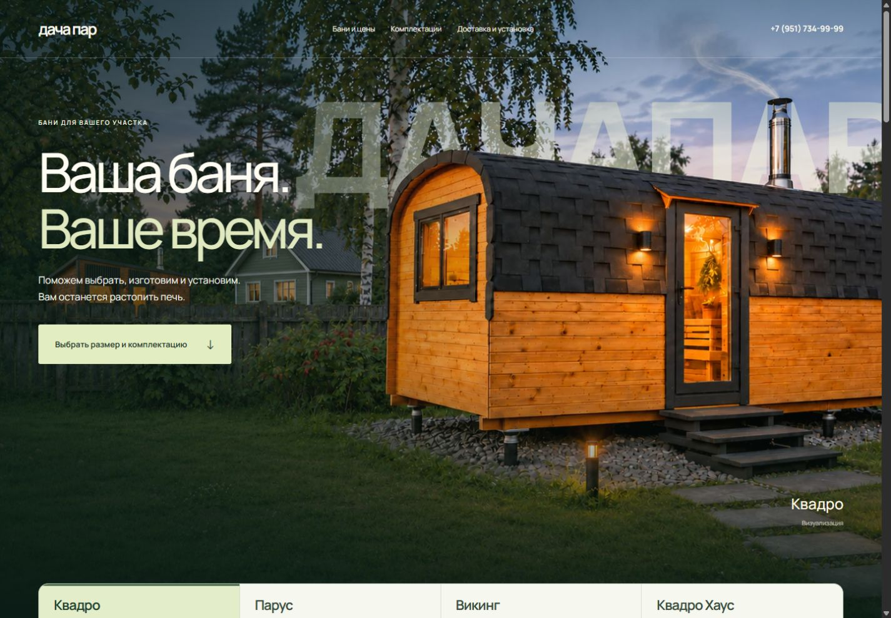
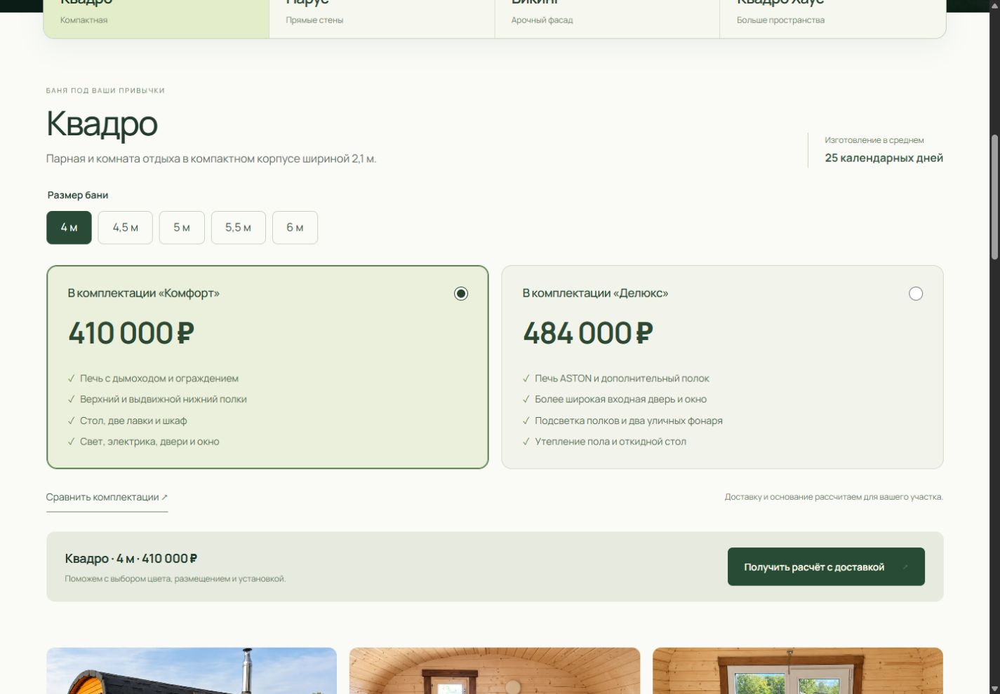
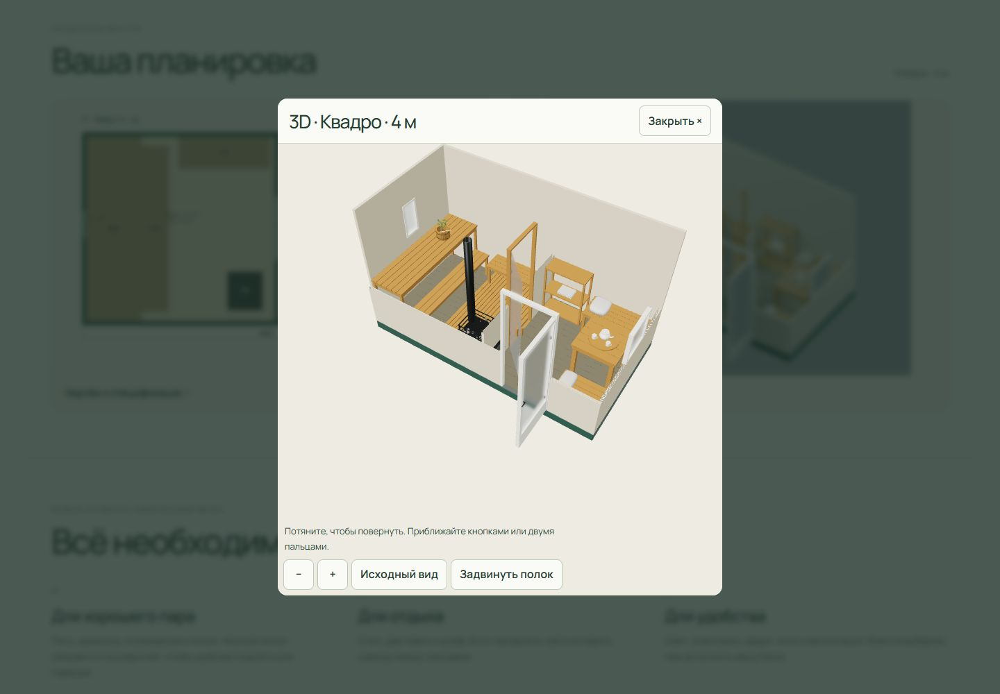

# ДачаПар: первый прототип единого выбора

Ветка `codex/bath-choice-v2`, исходная основа `3c62423`. Прототип сделан отдельно от опубликованного выпуска `SPEC-CLEAN-be544b9fb6464bd4`. Это этап 1 и первый эталон этапа 2 из плана `docs/renewal-2026-11-04` в рабочей папке проекта. Производственный выпуск и переключение сервера не выполнялись.

## Готово для просмотра

- Единственный ряд четырёх моделей внизу первого экрана меняет сцену и последующий выбор.
- Размер, две карточки комплектаций, краткие различия, сравнение в окне и подробности на странице.
- Двенадцать отобранных реальных фотографий, по три на модель. Повторной большой hero-фотографии нет.
- Фильтрация планировок по точной паре модели и размера; ссылки сохраняют размер, комплектацию и вариант. Back восстанавливает выбор.
- Срок изготовления 25 календарных дней, сборка в среднем 2–3 дня, доставка готовой бани или комплекта, помощь с основанием и онлайн-показ производства.
- Формы сохраняют выбор. Кнопки расчёта, консультации и онлайн-показа открывают соответствующий текст обращения.
- Подключён текущий опубликованный R117, скопированный без изменения байтов. Пройдены три шага до результатов без отправки заявки.
- Новый эталон «Квадро» 4 м: светлые стены, более тёмный пол, медовая мебель и действие нижнего полка в GLB.

## Связка эталона

| Файл | Назначение |
|---|---|
| `pilot/01.blend` | Редактируемая сцена с упакованными текстурами, до среза стен для превью. |
| `pilot/01-dimension-source.json` | Размерный источник новой ревизии, связь с родителем. |
| `pilot/01.json` | Фактические элементы, границы и клиентская спецификация. |
| `pilot/01.svg` | Чертёж с новым нижним полком. |
| `pilot/01.glb` | Настоящий переносимый 3D с узлом перемещения. |
| `pilot/01.webp` | Превью с разными материалами. |
| `pilot/01-geometry-check.json` | Проверка полного хода в Blender. |
| `pilot/01-export-audit.json` | Независимая проверка уже экспортированных вершин и преобразований GLB. |

Нижний полок: 1810 × 300 мм, поверхность 450 мм, вылет в плане x=645…945 мм; ход −330 мм по X. Укорочен на 100 мм с каждого конца относительно родителя, чтобы обойти опоры верхнего полка. Полный ход всех 12 подвижных деталей проверен против стационарной геометрии без пересечений. Перед массовым переносом узел следует согласовать с производством; проверка несущей способности в эту визуализацию не входит.

Новые материалы пока применены только к этому эталону. Остальные схемы показывают предыдущую ревизию. Узел СТ1/НС1 в 4×4 и пять недостающих геометрий идут следующим этапом. Текущая связка закрывает 13 из 20 модельно-размерных сочетаний. Неподготовленный размер не получает чужую схему.

## Цены — отдельная рабочая сверка

После уточнения владельца подготовлены составы 14 геометрий, 17 модельных ведомостей и 34 черновых расчёта. Подробности и обнаруженные расхождения: [PRICING-REVIEW.md](PRICING-REVIEW.md).

`layout-pricing.mjs` — общий расчёт ведомости для сайта и квиза: оплаченные количества, новые помещения, дополнительные товары, подтверждённые замены. Неполная или неподтверждённая ведомость не выдаёт публичную конечную цену. Он пока не подменяет действующий ценовой движок и R117. Карточки прототипа сохраняют текущий публичный прайс, в котором обнаружена старая цена «Делюкса».

Исходные данные прочитаны из живых листов «Цены и прибыль», «Комплектации», «Методика», «РРЦ», «Тех · расчёт Делюкс», «02 · Состав Комфорт» и «Квиз» 04.11.2026. Сырые затраты остаются в `.local/pricing-sources/`, в публичную сборку не копируются. Архив «Планировки · экономика» не использован как утверждённый прайс.

Владелец утвердил базу помещений «Квадро Хаус» 3/4 для обеих комплектаций, решение сохранено в `pricing-decisions.json` и применено к ведомостям. До подключения единых конечных цен нужно закрепить комплектацию по каждому коду и недостающие тарифы; явно сопоставить 41 старую схему квиза с новым каталогом. Значения `null` не заменяются нулём.

## Сборка и проверка

Из корня worktree, Python с Pillow, Node.js 24+:

```powershell
python concepts/bath-choice/build.py
node concepts/bath-choice/preview.mjs
```

Сборка использует сохранённый публичный снимок R117 в `baseline/` и проверяет его хеши. Публичная книга цен совпала с репозиторной; при наличии `.local/renewal-baseline/catalog-pricebook.json` берётся этот захват, иначе проверенный `web/data/catalog-pricebook.json`. Также проверяются GLB-хеши, размерные ревизии и клиентские спецификации всех 14 схем. Генерируется `output/bath-choice-manifest.json` с `deploymentReady:false` и причинами незавершённости.

Локальный адрес: http://127.0.0.1:4192/. Сервер принимает только чтение, блокирует все POST и `/api/`, отключает аналитику. Статические зависимости читаются с основного сайта и кэшируются; производственные данные не записываются. Реальная доставка заявки этим просмотром не подтверждается.

```powershell
node --test tests/home-hero.test.mjs tests/bath-choice.test.mjs tests/layout-pricing.test.mjs tests/quiz.test.mjs tests/pricing-parity.test.mjs
python concepts/bath-choice/pricing_review.py
node concepts/bath-choice/review_quotes.mjs
python concepts/bath-choice/package_review.py
node concepts/bath-choice/verify-preview.mjs
```

Результат упаковки — `output/ДачаПар-прототип-выбора-и-3D-2026-11-04.zip`. Внутри статический просмотр, Node-сервер, редактируемый эталон и рабочая сверка цен. Нет установщика, серверных секретов и сценария публикации.

Blender 4.5.9 и поставляемый с ним Python с NumPy используются для геометрии. Для повторного запуска генератора: сначала `prepare_pilot_assets.py SOURCE`, затем Blender с `--python-exit-code 1 --python build_pilot.py -- SOURCE OUT WORK`, затем `prepare_pilot_assets.py SOURCE --finish` и `audit_pilot.py`. `SOURCE` — исходный каталог `Планировки/3D-каталог-14-03-11-2026-v1`; `OUT` — `concepts/bath-choice/pilot`; `WORK` — `.local/pilot-01`. Параметры пути разрешаются до открытия сцены. Опубликованные оригиналы не редактируются.

## Приёмка первого этапа

Результаты: [QA.md](QA.md). Визуальные снимки находятся в `output/review/`. Проверка понимания человеком и физический телефон ещё нужны; проверка узкого viewport в браузере их не заменяет. Следующий этап — узел 4×4 и общие широкие базы, затем недостающие размеры и интеграция в полный кандидат со старыми адресами.

## Снимки прототипа

На снимках цены пока соответствуют действующему публичному прайсу, до устранения расхождения и расчёта точных составов.






