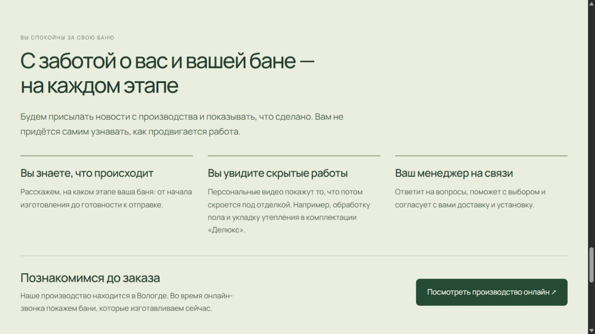

# ДачаПар: галерея, планировки и сопровождение

Ветка `codex/bath-choice-v2`. Изолированная разработка; на основной сайт не устанавливалась.

## Текущий путь покупателя

1. Один ряд четырёх моделей переключает первый экран и выбор. После нажатия открываются реальные фотографии выбранной модели.
2. Галерея: шесть фото каждой модели, миниатюры, стрелки, крупный просмотр и свайп. Крупные изображения загружаются при открытии.
3. Размер и две карточки комплектаций с ценами и полноценным кратким описанием. Рядом одна кнопка «Развернуть сравнение комплектаций». В окне явно подписаны «Комфорт» и «Делюкс»; на телефоне сравниваемые значения стоят рядом.
4. Планировка выбранного размера, крупный план с увеличением, описание помещений обычным языком и настоящий GLB. Под планом — запрос цены выбранной планировки и комплектации.
5. Камни, веник и отдых на полке, затем изготовление и установка, сопровождение и чайный финал.
6. Блок «С заботой о вас и вашей бане — на каждом этапе»: новости с производства, персональные видео скрытых работ, связь с менеджером и онлайн-показ производства.

Срок изготовления — в среднем 25 календарных дней. Сборка на участке — в среднем 2–3 дня, зависит от размера и конфигурации. Утепление и обработка пола в примере видео прямо отнесены к комплектации «Делюкс».

Исходный R117 сохранён без изменения байтов. Три приглашения на странице открывают тот же квиз: первый экран, помощь с выбором возле комплектаций и чайный финал. Полная таблица и повторные переходы «что входит» с основной страницы убраны.

## Один источник схем

Отдельная упрощённая SVG-отрисовка в этом интерфейсе больше не используется. Все 14 изображений взяты из нативного PDF Google Slides: сохранены топочный канал, дверца печи, камни, штриховка, обозначения и размерные цепочки. Сайт показывает обрезку области плана, а техническая легенда остаётся в рабочем альбоме. Сжатие WebP без потерь проверено по пикселям.

В `album/`: PDF, 14 изображений, манифест происхождения, сжатые нативные снимки до/после, проверка и обратные запросы. Альбом остаётся редактируемым. Нативные ID и весь ожидаемый текст проверены; максимальное отклонение границ после округления Google — 0,00157 pt.

В альбом перенесены уже существовавшие изменения: полок и лавка №01, раковины №07/09, нижние полки №11, размерная цепочка и положение ступени №13. Отдельные подвижные двери могут быть показаны под другим углом открытия в 3D.

`export_album_assets.py` только обрезает нативные страницы PDF; собственной геометрии схем он не рисует. Для новой выгрузки нужны Pillow и pypdfium2. Нативный экспорт Google выполняется через Google Slides skill. Обычная сборка использует уже сохранённые изображения и этих зависимостей не требует.

## 3D и границы этого этапа

В `pilot/` сохранён эталон «Квадро» 4 м: редактируемый Blender, GLB с движением нижнего полка, размерный источник, спецификация и отчёты. Нижний полок 1810×300 мм, ход 330 мм. Независимо проверены уже экспортированные вершины и полный ход без пересечений. Старый `pilot/01.svg` сохранён как архивный файл и не подключён к интерфейсу.

Материалы и подвижный полок пока новые только в этом эталоне. Следующий геометрический блок: узел СТ1/НС1 в 4×4, широкие базы и перенос материалов; затем пять недостающих геометрий. Сейчас точно покрыты 13/20 сочетаний. При неподготовленном размере показана помощь с планировкой; чужая схема не подставляется. Это прототип, не готовый релиз.

## Цены

Карточки сохраняют действующий публичный прайс. Точные конечные цены каждой планировки под схемой не выводятся. Подробности внутреннего расчёта 34 смет и выявленного старого прайса «Делюкса» — в [PRICING-REVIEW.md](PRICING-REVIEW.md).

База помещений «Квадро Хаус» 3/4 уже утверждена владельцем для обеих комплектаций; заново согласовывать не требуется. Неизвестные изделия не считаются бесплатными. Владелец утвердил кухню OPT_97 по 37 900 ₽ клиенту, с раковиной и смесителем в составе одного комплекта. Диван, кровать и остальная сантехника вынесены на отдельное согласование, с пометкой в описаниях соответствующих планов. Эти предметы не считаются бесплатными. Для окончательных цен остаются сопоставления мебели и подтверждение состава.

## Запуск

Из корня worktree, Python с Pillow и Node.js 24+:

```powershell
python concepts/bath-choice/build.py
node concepts/bath-choice/preview.mjs
```

Адрес http://127.0.0.1:4192/. Локальный сервер блокирует POST и `/api/`, отключает аналитику. Реальные заявки не отправлялись; доставка в MAX не проверялась.

```powershell
node --test tests/home-hero.test.mjs tests/bath-choice.test.mjs tests/layout-story.test.mjs tests/layout-pricing.test.mjs tests/quiz.test.mjs tests/pricing-parity.test.mjs
python concepts/bath-choice/package_review.py
node concepts/bath-choice/verify-preview.mjs
```

Пакет: `output/ДачаПар-галерея-планы-и-забота-2026-11-04-v3.zip`. Внутри локальный просмотр, редактируемый эталон, нативный альбом и рабочая сверка цен. Установщика и публикации нет.

Актуальная проверка: [QA-V3.md](QA-V3.md). [QA.md](QA.md) и старые снимки `review/` относятся к предыдущему прототипу.




